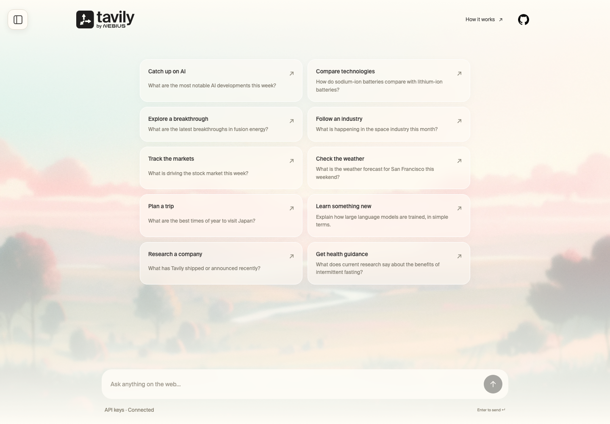

# Tavily Chat



A simple chat demo with live web search, streaming answers, and visible sources. Built with the Tavily landscape visual system: warm paper, local Suisse fonts, translucent surfaces, and a quiet chat layout.

The default demo needs **a Tavily API key and an OpenAI API key**. A bounded tool harness uses regular Tavily Search for evidence, then streams an OpenAI answer with citations. No database is required. The original LangGraph implementation remains available in [`app.py`](app.py), [`backend/`](backend), and [`ui/`](ui); see [the LangGraph setup guide](docs/langgraph-example.md).

## Run the chat demo

Requires Node.js 24 or newer.

```bash
git clone https://github.com/tavily-ai/tavily-chat.git
cd tavily-chat
npm ci
cp .env.example .env
# Set TAVILY_API_KEY and OPENAI_API_KEY in .env, or use API keys in the browser.
npm run dev
```

Open **http://127.0.0.1:3000**. Choose a suggested question or type your own. Connect both keys with the API keys control beneath the message box.

```bash
# Optional custom port
PORT=4317 npm run dev

# Production build and server
npm run build
npm start

# Tests, no API key or external network calls required
npm test
```

### Container

```bash
docker build -t tavily-chat .
docker run --rm -p 3000:3000 --env-file .env tavily-chat
```

The default `Dockerfile` serves the new Node chat demo on port 3000. The former Python server image is preserved as `Dockerfile.langgraph`, running the original API on port 8080:

```bash
docker build -f Dockerfile.langgraph -t tavily-chat-langgraph .
```

## What the demo shows

- Conversational follow-ups grounded in fresh web search.
- Actual planning, search queries, source discovery, and streamed answer chunks.
- Markdown lists, code blocks, and horizontally scrollable tables.
- Numbered citation links and a visible source list under each answer.
- Suggested questions, stop/retry controls, and a left-side chat history panel with new-chat, reopen, and delete actions.
- A responsive layout, keyboard controls, visible focus states, and reduced-motion support.

Enter sends a message; Shift+Enter inserts a line break. The left-side chat panel saves conversations in this browser, so they can be reopened after a refresh. Starting a new chat preserves older chats; delete one from the panel when it is no longer needed. API keys stay only in memory. While an answer is running, use Stop to cancel the local stream.

## How it works

```text
React chat → POST /api/chat → OpenAI: focused search tool call
                           → Tavily /search (fast, up to ten results per query)
                           → OpenAI: streamed answer with numbered citations
           ← SSE activity, sources, answer text, completion
```

Each request includes the latest question and up to three completed question/answer pairs. OpenAI resolves follow-up references into two complementary queries for primary evidence and independent corroboration. The server executes two Tavily Search calls in parallel, with topic-specific primary publisher domains on the first query, then returns bounded source excerpts to OpenAI with further tool calls disabled. The default model is GPT-4.1 mini; Responses API requests use `store: false`.

Search uses `search_depth: "advanced"`, without Tavily-generated answers or raw page content. The answer streams as OpenAI produces it. A 90-second overall timeout and a 2,000-token answer limit bound each turn. This avoids a multi-step Research job; actual latency depends on both providers.

Tracking parameters and fragments are removed for deduplication. Up to eight sources are selected with at most two pages per publisher, preserving relevance order within each publisher. This is a diversity heuristic, not a credibility guarantee. Source IDs are assigned before synthesis and shared by the model and UI. Unsafe URLs are removed without shifting remaining IDs. Empty search results tell the model to acknowledge missing evidence. Citations indicate model attribution; the app does not independently verify every claim.

## Configuration

| Setting | Purpose |
| --- | --- |
| `TAVILY_API_KEY` | Optional server-side key. A key entered in the tab overrides it for that request. |
| `OPENAI_API_KEY` | Server-side OpenAI key; a tab key overrides it. |
| `OPENAI_MODEL` | Responses-compatible model with function calling; default `gpt-4.1-mini`. |
| `PORT` | Server port, default `3000`. |
| `HOST` | Bind address, default `127.0.0.1`; containers use `0.0.0.0`. |
| [`demo.config.mjs`](demo.config.mjs) | Suggested questions, default OpenAI model, 90-second timeout, and input limits. |

A question can contain up to 2,000 characters. The browser stores conversations locally; requests send at most six previous messages from the active chat. Failed and stopped answers are excluded from follow-up context.

## API

`GET /api/health` returns readiness and whether each provider’s server key is configured, never the key itself.

`POST /api/chat` accepts:

```json
{
  "message": "How does that compare with lithium-ion?",
  "history": [
    {"role": "user", "content": "What is a sodium-ion battery?"},
    {"role": "assistant", "content": "A previous completed answer."}
  ],
  "apiKey": "optional-tavily-tab-key",
  "openaiApiKey": "optional-openai-tab-key"
}
```

The response is `text/event-stream` with JSON `data:` payloads. Event types are `activity`, `discovery`, `content`, `sources`, `complete`, and `error`. Disconnecting the browser aborts the upstream HTTP connection. Either provider may already have incurred usage; stopping the local stream does not guarantee cancellation of provider billing.

## Project layout

```text
src/                     New React chat, Markdown citations, shared SSE parser
server/                  Small Node HTTP server and Search and OpenAI tool harness
public/                  Tavily assets, local fonts, saved example conversation
test/                    Streaming, context, citations, API, and failure tests
demo.config.mjs          Demo configuration
app.py, backend/, ui/    Original LangGraph agent and its frontend
docs/langgraph-example.md  Original agent setup and architecture
```

The new chat is started with the **root** npm scripts. Running npm scripts inside `ui/` starts the original LangGraph frontend, which uses the original Python backend and provider keys.

## Demo boundaries

- Questions and recent conversation context are sent to OpenAI. The generated search query is sent to Tavily; source excerpts are returned to OpenAI. Keys are held in memory or server environment variables and are never stored in browser storage. Conversations are stored locally in the browser, not in a database, analytics, or application logs.
- Search calls consume Tavily credits; OpenAI calls incur token usage. The UI shows actual search stages while waiting.
- The server applies a request size bound, a short per-IP cooldown, and a two-request concurrency cap. It rejects browser cross-origin requests and renders Markdown without raw HTML or remote images.
- This is a local demo, not a public authenticated service. Put authentication and per-user quotas in front of a deployment that uses a shared server key.

## Documentation

- [Tavily Search API](https://docs.tavily.com/documentation/api-reference/endpoint/search)
- [OpenAI function calling](https://developers.openai.com/api/docs/guides/function-calling)
- [OpenAI streaming](https://developers.openai.com/api/docs/guides/streaming-responses)
- [Original LangGraph agent](docs/langgraph-example.md)

The original project license remains in [LICENSE](LICENSE). Tavily brand assets are reused from the other Tavily demo projects for this Tavily-branded demo.
